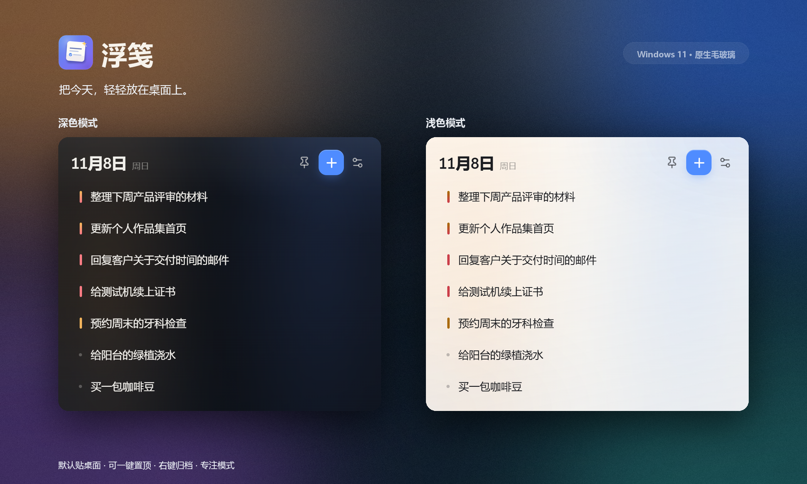
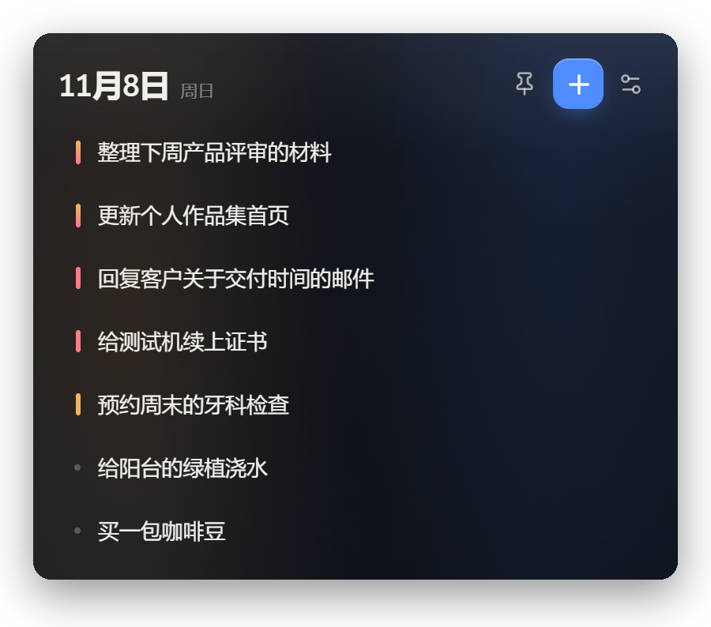
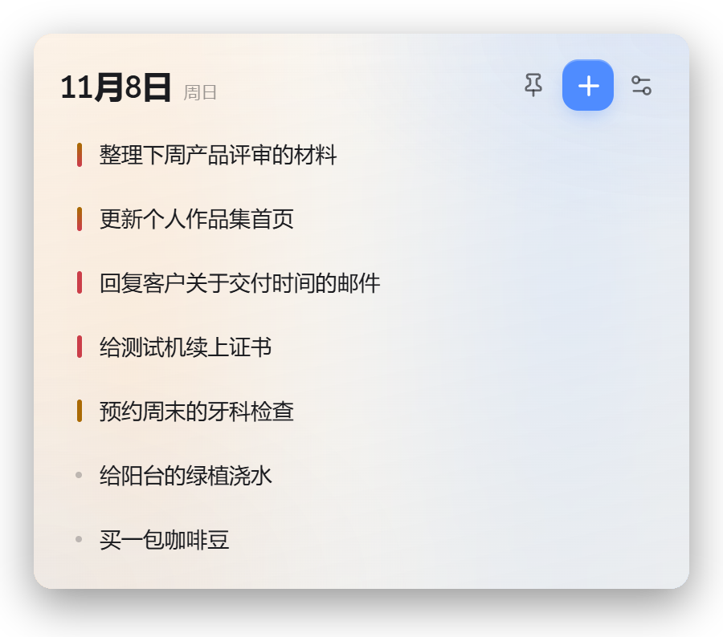
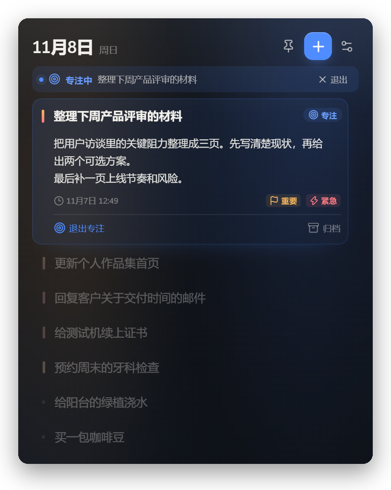
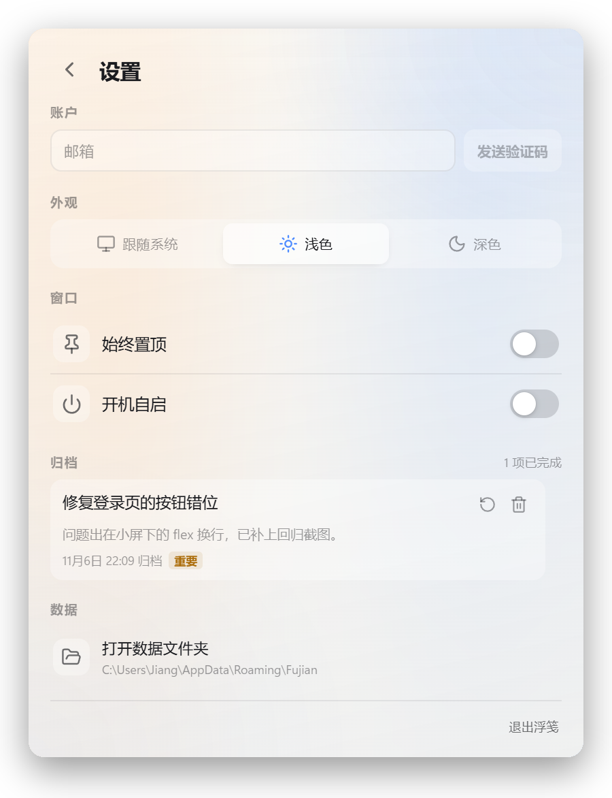
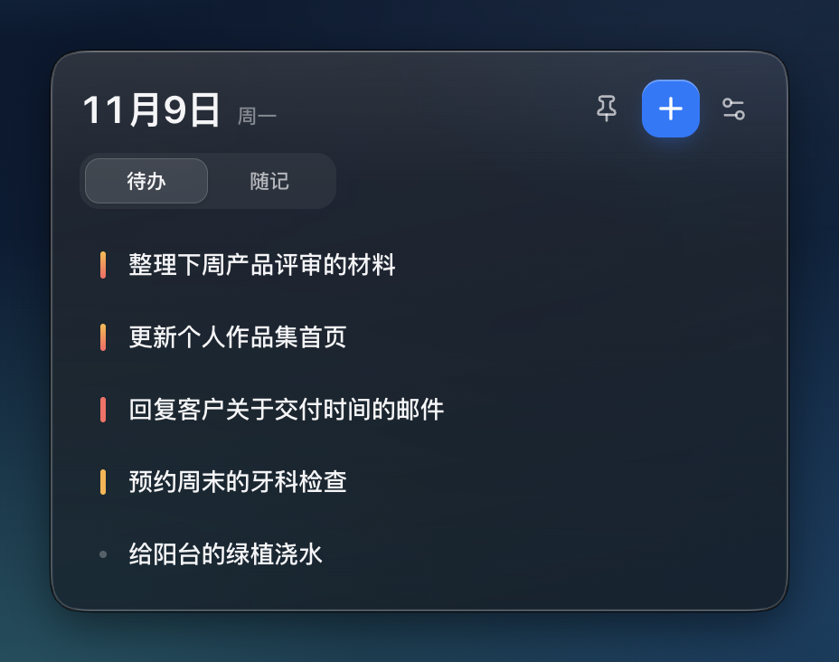
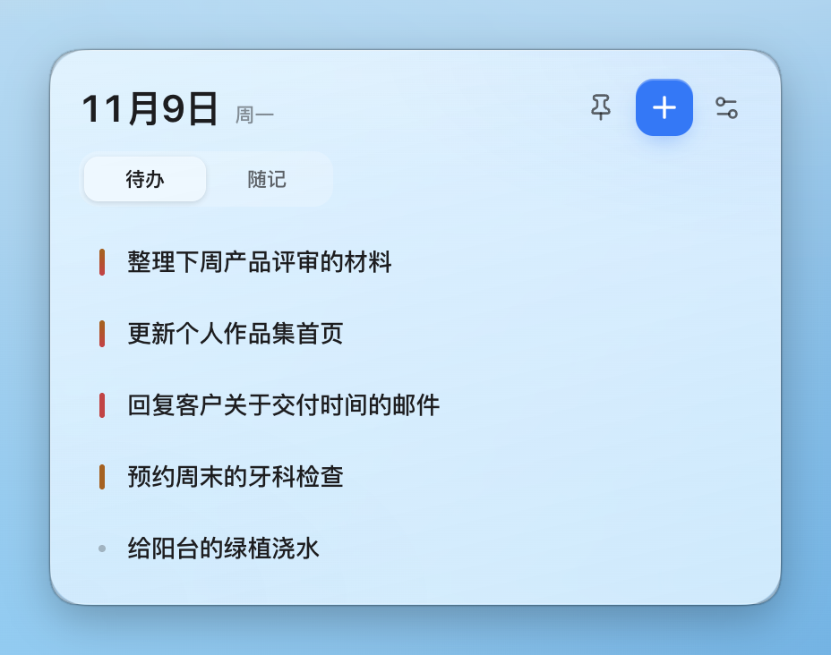
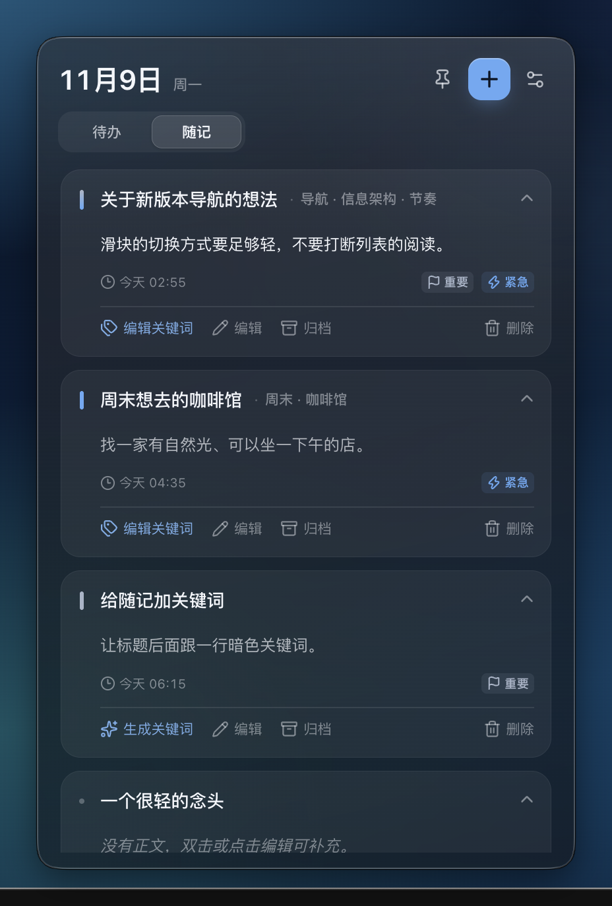
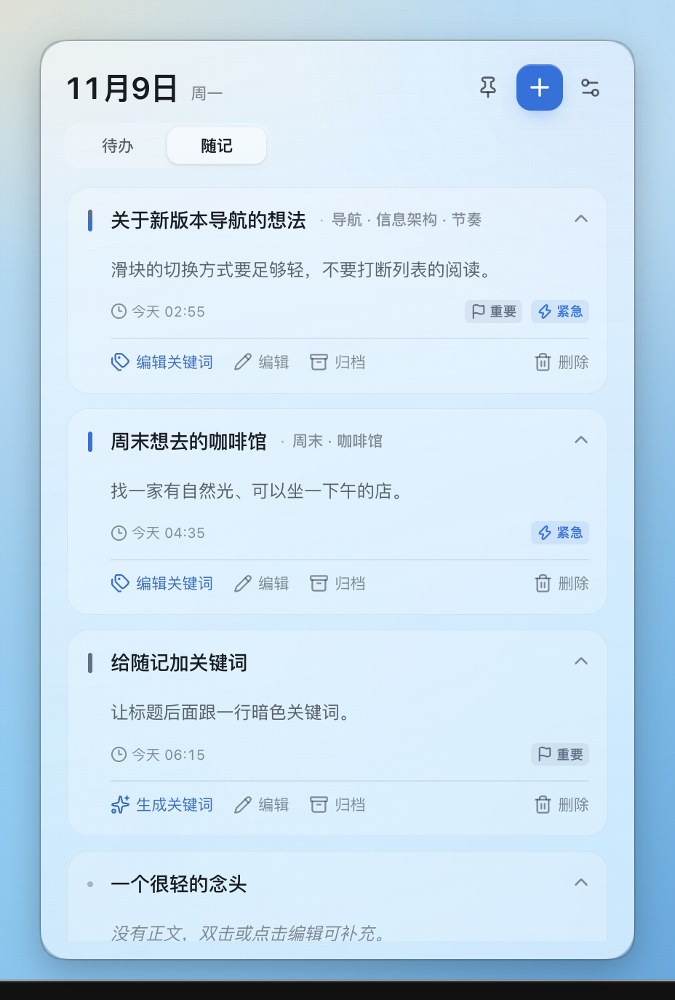

# 浮笺

> 把今天要做的事，轻轻放在桌面上。

一个跨平台的无边框桌面任务便签，也是一块随手记录想法的随记板。默认安静地待在桌面角落；Windows 11 使用原生 Acrylic，macOS 26 使用原生 Liquid Glass，并跟随系统切换深色 / 浅色主题。两个平台共用同一套界面、账号、任务和随记数据。



## 官网

下载页：[fujian.fyi](https://fujian.fyi)

## 交付文件

- Windows 运行文件：`浮笺.exe`（1.3.0）
- Windows 校验值：同目录 `浮笺.exe.sha256`
  - SHA-256：`45f9d4e1ffbdb90174ce92a1df3f86ee5aaff1b3809f502a2eb81293b1e68c58`
- macOS：在 Mac 上执行 `npm run build:mac:dir`，产物为 `dist/mac-arm64/浮笺.app`；
  未签名版本仅适合本机测试，签名和公证说明见 [`docs/MACOS.md`](docs/MACOS.md)。
- 源码：仓库根目录
  - 包含 `src/`、`tests/`、`scripts/`、`docs/`、构建配置和使用文档。
  - 运行文件、源码、用户数据三者分开存放；清理或更新运行文件不会删除源码或任务数据。

## 功能

- **只显示标题**：桌面列表保持干净，点击任务后才展开备注。
- **待办 / 随记**：主页面小滑块切换；随记同样支持重要 / 紧急标记，并按相同规则排序。
- **随记归档**：随记可以归档到设置页，恢复或永久删除，和待办归档共用同一套入口。
- **随记默认展开**：随记列表默认展开一段正文预览（内容过长时在预览区内滚动），点标题可收起；标题为空时自动使用当天日期（如 `20261109`），日期标题以更暗的字重显示。
- **原位编辑**：双击随记正文或点「编辑」会直接在当前卡片里展开编辑，光标落在点击位置，不会在顶部再生成一张重复的编辑卡片；编辑框自动增高，其他随记平滑下移。
- **随记关键词**：标题后跟一行较暗的关键词；没有关键词时可生成，已有关键词时可手动编辑；设置页只批量为缺少关键词的随记生成。
- **快速添加**：标题、可选备注，重要 / 紧急两种标记。
- **四级排序**：重要且紧急 → 仅紧急 → 仅重要 → 普通；同层级按创建时间从早到晚。
- **专注模式**：完整展示当前任务的备注，其余任务自动变暗。
- **右键归档**：任务和随记都可以归档；设置页的归档默认收起，点击后展开到固定高度并可滚动，支持恢复或永久删除。
- **原生玻璃质感**：Windows 11 Acrylic + DWM 圆角阴影；macOS 26 Liquid Glass；旧版 macOS 回退到 vibrancy。
- **无边框挂件**：无标题栏、无外框；macOS 隐藏红黄绿按钮和 Dock 图标，常驻菜单栏。
- **融入系统**：支持跟随系统 / 浅色 / 深色，自动使用系统强调色，并按明暗派生适合的明度。
- **单一蓝色主调**：浅色主题用更深的钴蓝保证对比，深色主题把蓝色提亮；「重要」使用冷中性色，「紧急」沿用主蓝，黄色不再出现在常规列表里；红色只保留给删除和错误。
- **桌面置顶**：默认像桌面组件一样位于普通窗口后方，点图钉可悬浮在所有窗口之上。
- **开机自启**：可选；Windows 使用启动文件夹，macOS 使用 Login Item。
- **本地数据**：自动保存、原子写入、自动保留上一份备份。
- **账号同步**：邮箱验证码登录；同一账号可在不同设备同步任务和随记。登录后本地数据先合并上传，之后本地修改与云端双向同步。

## 界面预览

| 深色 | 浅色 |
| --- | --- |
|  |  |

| 专注模式 | 设置与归档 |
| --- | --- |
|  |  |

> 预览图中的桌面背景为合成效果，用来展示玻璃透明度；实际背景是当前 Windows 桌面，由系统 Acrylic 实时模糊。

macOS 26 原生 Liquid Glass（同样使用合成桌面壁纸演示透明材质）：

| 深色 | 浅色 |
| --- | --- |
|  |  |

随记视图与关键词（标题后的暗色关键词；展开后可生成或编辑关键词）：

| macOS 随记 · 深色 | macOS 随记 · 浅色 |
| --- | --- |
|  |  |

## 运行

### Windows

1. 运行构建产物 `浮笺.exe`，或把便携版放到一个可写目录后双击。
2. 首次运行 Windows SmartScreen 可能提示“Windows 已保护你的电脑”。这是未签名个人应用的正常提示：点“更多信息” → “仍要运行”。

不需要安装，也不会注册后台服务。单文件启动时会先解压运行时到本机临时目录，首次启动会稍慢。

> **这台机器必须放在 C: 盘运行。** 本机存在一条按“程序所在磁盘”生效的访问限制：位于 D: 盘的可执行文件无法写入 C: 用户目录。放在 D: 盘会导致应用无法创建用户数据/缓存而启动失败；放到 C: 盘（例如当前目录）后，任务保存、Chromium 缓存和开机自启都正常。这个限制与浮笺本身无关，换到正常机器后可以放在任意盘。

它不会出现在任务栏；关闭窗口（`Alt + F4`）会收进系统托盘。

### macOS

1. 在 Mac 上安装 Node.js 22+，进入项目目录执行 `npm ci`。
   - 如果 Windows 上已经配置过账号同步，项目根目录的 `.env.local` **不会随 git 过来**；
     把 Windows 项目根目录的 `.env.local` 复制到 Mac 项目根目录，或按 `.env.example`
     重新填写 `SUPABASE_URL` / `SUPABASE_PUBLISHABLE_KEY`。账号配置是构建时注入的，
     填完必须重新执行构建。
2. 执行 `npm run build:mac:dir`，打开 `dist/mac-arm64/浮笺.app`。
3. 未签名版本第一次启动可能被 Gatekeeper 拦截，可在“系统设置 → 隐私与安全性”
   中允许，或对本地构建执行 `xattr -dr com.apple.quarantine "dist/mac-arm64/浮笺.app"`。

macOS 版不会出现在 Dock；关闭窗口（`Cmd+W`）会收进菜单栏。点击菜单栏图标
显示 / 隐藏窗口，右键打开菜单。`Cmd+N` 新建任务，`Cmd+,` 设置与归档，
`Cmd+Q` 退出。

## 迭代与更新

源码完整保留在仓库根目录。Windows 更新流程：

1. 从设置页底部或托盘菜单退出浮笺（运行中的 exe 会被占用，无法覆盖）。
2. 修改源码；如需改版本号，编辑 `package.json` 的 `version`。
3. 在项目目录运行：

```bash
npm run release
```

`npm run release` 会自动：

- 用 D: 盘的临时目录构建（规避本机的 C:/D: 访问限制）；
- 把最新单文件安装到固定的本地运行路径；
- 更新 `.sha256` 校验文件；
- 删除旧的带版本号 exe / ZIP；
- 保留 `%APPDATA%\Fujian` 里的任务与设置；
- 如果开机自启已开启，把启动快捷方式改指向新的稳定路径。

稳定文件名意味着以后覆盖升级不需要重新开启自启；任务数据也不会因为换版本丢失。

> 现在已经是稳定入口 `浮笺.exe`。以后更新只需退出应用并运行一次 `npm run release`；新版本会替换同一个文件，任务数据和开机自启路径都保持不变。

## 跨平台开发

Windows 1.3.0 稳定运行；macOS 版已在 macOS 26.0.1 / Apple Silicon 上完成窗口、
原生玻璃、菜单栏、Dock 隐藏、快捷键和打包验证，详见
[`docs/MACOS.md`](docs/MACOS.md)。Intel / universal 包和签名公证仍需后续验证。

- 一个仓库、一个 `main` 分支，不维护长期并行的 Windows/macOS 分支
- 共用 React UI、任务/随记模型、本地存储和 Supabase 同步
- Windows 与 macOS 的窗口材质、开机自启、应用菜单放在 `src/main/platform/`
- macOS 构建必须在 macOS 上执行

详见 [`docs/CROSS_PLATFORM.md`](docs/CROSS_PLATFORM.md)。

GitHub 推送步骤见 [`docs/GITHUB.md`](docs/GITHUB.md)，公开前的安全边界见 [`docs/SECURITY.md`](docs/SECURITY.md)。

## 操作方式

| 想做什么 | 怎么做 |
| --- | --- |
| 新建任务 | 点右上角 `+`，或按 `Ctrl + N` |
| 切换待办 / 随记 | 主页面日期下方的「待办 / 随记」滑块 |
| 新建随记 | 在随记视图点 `+`；macOS 也可按 `Cmd + Shift + N` |
| 随记关键词 | 无关键词：展开随记 →「生成关键词」；已有关键词：展开随记 →「编辑关键词」；批量：设置 → 账户 →「为没有关键词的随记生成关键词」 |
| 默认日期标题 | 新建随记不填标题即自动使用当天日期；直接输入则以输入内容为准 |
| 编辑随记 | 双击正文可在光标位置原位编辑，或点「编辑」；`Cmd + Enter` 保存 |
| 选择重要 / 紧急 | 在输入框底部点对应的标记，两者可同时选 |
| 保存任务 | 在标题栏按 `Enter`；在备注中按 `Ctrl + Enter` |
| 展开 / 收起备注 | 点击任务标题 |
| 进入专注模式 | 展开任务后点「专注模式」 |
| 退出专注 | 点顶部专注条上的「退出」，或任务内的「退出专注」 |
| 归档任务 | 右键任务 →「归档（完成）」；也可在展开后点「归档」 |
| 归档随记 | 展开随记 →「归档」，或右键 →「归档随记」 |
| 恢复 / 删除归档 | 设置 →「归档」→「查看归档」；展开后可滚动查看任务和随记 |
| 置顶窗口 | 点日期右侧的图钉图标 |
| 移动窗口 | 按住顶部日期区域拖动 |
| 设置 | 点右上角分隔线图标 |
| 配置 DeepSeek | 设置 → 账户 →「AI 关键词」输入 Key 并保存 |
| 隐藏窗口 | `Alt + F4`，之后可在系统托盘重新打开 |
| 退出应用 | 设置页最下方的「退出浮笺」，或托盘菜单 →「退出浮笺」 |
| 切换主题 | 设置 →「外观」；默认跟随系统 |

macOS 额外操作：

| 想做什么 | 怎么做 |
| --- | --- |
| 新建任务 | `Cmd + N`，或菜单栏图标右键 →「新建任务」 |
| 打开设置 | `Cmd + ,`，或菜单栏图标右键 →「设置与归档」 |
| 隐藏窗口 | `Cmd + W`；窗口收进菜单栏，不退出应用 |
| 显示 / 隐藏窗口 | 左键点击菜单栏图标 |
| 退出应用 | `Cmd + Q`，或菜单栏图标右键 →「退出浮笺」 |
| 隐藏应用 | `Cmd + H`；从菜单栏图标重新打开 |

## 排序规则

1. 重要且紧急
2. 仅紧急
3. 仅重要
4. 普通

同一层级内按任务创建时间从早到晚排列。新增、编辑标记或恢复归档后都会自动重新排序。

## 账号与同步

在设置页的「账户」区域：

1. 输入邮箱，点「发送验证码」
2. 从邮箱读取 6 位数字验证码
3. 输入验证码并登录

登录成功后：

- 本地任务和随记会先上传到云端
- 之后每次本地修改会延迟同步；窗口重新获得焦点时也会同步
- 同一账号在另一台设备登录后，会拉取云端任务和随记
- 设置页可以手动点「同步」，也可以「退出」

当前同步策略是**任务和随记分别按 id 合并、服务端时间较新者优先**；删除使用云端墓碑，避免内容从另一台设备复活。

当前使用自有域名 `fujian.fyi` + Resend 发信，发件人为 `noreply@fujian.fyi`。公开注册前必须：

- 增加发码限流、邀请码/验证码和滥用防护
- 处理多账号在同一台电脑上的数据隔离
- 补充隐私政策、账号删除和备份策略

Supabase 初始化步骤见 [`supabase/SETUP.md`](supabase/SETUP.md)。

## 数据与隐私

- Windows 数据目录：`%APPDATA%\Fujian\`
- macOS 数据目录：`~/Library/Application Support/Fujian/`
  - `tasks.json`：任务和归档
  - `notes.json`：随记、关键词和归档状态
  - `settings.json`：主题、窗口位置、开机自启偏好
  - `llm-key.bin`：系统安全存储加密的 DeepSeek API Key（仅本机）
  - `cloud-auth.bin` / `cloud-sync.json`：登录会话与同步辅助状态（登录后）
  - 同名 `.bak` 文件：最近一次写入前的自动备份
- 在设置页点「打开数据文件夹」即可定位。
- 未登录时所有数据只保存在本机；登录后任务和随记会通过 Supabase 同步，设置和 LLM Key 仍只保存在本机。
- 任务和随记保存采用临时文件 + 原子替换；读取失败时会尝试 `.bak` 备份，并把损坏文件保留为 `.corrupt-*`。

## 开机自启说明

Windows 开启后，浮笺会在以下位置创建一个 `浮笺.lnk`：

`%APPDATA%\Microsoft\Windows\Start Menu\Programs\Startup\`

快捷方式指向外层单文件便携 exe 本身（不是它的临时解压目录），因此启动时会自动完成自解压。关闭开关会删除该快捷方式。它不使用系统服务，也不需要管理员权限。

如果你移动了 exe，请先关闭再重新开启一次开机自启，让快捷方式指向新位置；同时保持它在 C: 盘。

macOS 使用系统的 Login Item（`app.setLoginItemSettings`），在“系统设置 → 通用 →
登录项”中可以看到，不需要创建快捷方式。

## 系统要求

- Windows 11 22H2 或更高版本：完整 Acrylic 毛玻璃、DWM 圆角与窗口阴影。
- Windows 10 / 较旧版本：自动降级为无边框纯色玻璃外观，其他功能不变。
- macOS 13 Ventura 或更高版本；macOS 26 Tahoe 使用新的 Liquid Glass，13–15
  使用 vibrancy。已在 Apple Silicon 上验证，Intel / universal 包待验证。
- 无需安装 Node.js、.NET 或运行库（仅运行构建产物时）；macOS 构建需要 Node.js 22+。

## 已知边界

- **本机路径限制**：D: 盘上的可执行文件无法写入 C: 用户目录（API 返回 Access Denied），因此单文件 exe 必须放在 C: 盘。这个限制也是最初 NSIS 单文件打包失败的原因：NSIS 默认把临时数据块映射到 C: 的 `TMP`，而 makensis 位于 D: 盘；构建时把 `TEMP`/`TMP` 指到 D: 即可正常打包。
- 这是未签名的个人应用；第一次运行可能出现 SmartScreen 提示。
- 默认不置顶，会被普通窗口盖住；需要常驻最前时点图钉。
- macOS 版使用私有 AppKit `NSGlassEffectView` 提供 Liquid Glass，系统更新可能
  影响材质；代码有 vibrancy / 半透明回退。
- macOS 版没有 Dock 图标，退出请用菜单栏右键菜单或 `Cmd+Q`。
- 任务和随记登录后会同步到 Supabase。首次使用需要在 Supabase SQL Editor 执行 `supabase/migrations/002_notes.sql` 创建 `notes` 表（详见 `supabase/SETUP.md`）；未登录时随记只保存在本机 `notes.json`。
- 随记关键词调用 DeepSeek 官方 API；API Key 使用系统安全存储保存，不会上传到 Supabase，也不会出现在设置页明文中。
- 归档不是删除；归档内容仍保留在本机和账号的 `notes` / `tasks` 表中，永久删除才是不可恢复操作。
- 当前不包含提醒、重复任务或番茄钟。专注模式按需求只做视觉聚焦，不设置倒计时。
- 删除归档是永久操作，需要二次确认；普通任务需先归档，随记可以直接删除（同样二次确认），也可以先归档保留。

## 开发

技术栈：Electron 45 + React 19 + TypeScript + Vite。

```bash
npm install
npm run dev
```

打包 Windows 单文件便携版：

```bash
npm run build:win
```

macOS：

```bash
npm run build:mac:dir    # 未打包 .app，当前架构（Apple Silicon）
npm run build:mac:arm64  # 明确 arm64
npm run build:mac        # 配置里的 dmg + universal（需验证 Intel 运行时）
```

macOS 26 的 Liquid Glass 通过可选依赖 `electron-liquid-glass` 使用原生
`NSGlassEffectView`；Windows / Linux 安装时会跳过该依赖，运行时代码也会回退。
构建产物未签名，签名和公证步骤见 [`docs/MACOS.md`](docs/MACOS.md)。

产物为 `dist/浮笺-1.3.0-便携版.exe`，以及可直接运行的 `dist/win-unpacked/` 目录。

在本机打包时，NSIS 编译器位于 D: 盘，需要把临时目录也放到 D: 盘，否则会触发上述 C:/D: 访问限制并报 `error creating mmap`：

```powershell
$env:TEMP = "tests\.tmp\nsis-build-temp"
$env:TMP = $env:TEMP
npm run build:win
```

中国大陆网络下如果 Electron / electron-builder 下载较慢，可以设置镜像：

```bash
# PowerShell
$env:ELECTRON_MIRROR = "https://npmmirror.com/mirrors/electron/"
$env:ELECTRON_BUILDER_BINARIES_MIRROR = "https://npmmirror.com/mirrors/electron-builder-binaries/"
npm run build:win
```

### 测试

```bash
npm run build
npm run test:ui       # 隐藏窗口的功能与交互测试
npm run test:layout   # 单任务窗口高度、底部空白和添加面板布局测试
npm run test:packaged # 需要先构建 win-unpacked；验证打包版与开机自启
npm run test:portable-c  # 从 C: 盘验证单文件 exe、数据保存和开机自启
npm run test:mac       # macOS 菜单、Dock 隐藏、平台样式（非 macOS 自动跳过）
npm run test:notes     # 待办/随记切换、随记 CRUD、归档、排序、关键词入口和 API Key 设置
npm run preview       # 用本机 Chrome 无头生成原始预览图到 docs/raw/
python scripts/frame_previews.py  # 合成 docs/preview*.png
```

测试使用 `FUJIAN_TEST_HIDDEN=1`，不会显示或激活窗口。

中国大陆网络下 `npm install` 也可能因下载 Electron 卡住，可先设置上面的镜像变量。

### 目录

```text
src/main/            主进程：窗口、托盘、IPC、主题、数据
src/main/platform/   Acrylic / Liquid Glass / 菜单 / 开机自启等平台差异
src/preload/         安全桥接
src/renderer/        React 界面
src/shared/          类型与排序逻辑
resources/           托盘图标、应用图标、macOS template image
build/               打包图标
tests/               隐藏窗口测试、macOS 测试与预览脚本
docs/                预览图与平台说明
```

## 更新记录

- **1.3.0**：合并随记、DeepSeek 关键词、统一蓝色配色和 macOS Liquid Glass 适配；增加随记与 Windows 回归测试。
- **随记与 AI 关键词（并入 1.3.0）**：主页面待办/随记滑块、随记默认展开预览、日期兜底标题、重要/紧急同规则排序、标题后关键词、单条与批量 DeepSeek 生成、本机加密保存 API Key。随记登录后通过 `notes` 表同步。
- **macOS（并入 1.3.0）**：macOS 26 原生 Liquid Glass、无标题栏/红黄绿按钮、菜单栏挂件、隐藏 Dock、SF Pro 字体、macOS 应用菜单与 Cmd 快捷键；Windows 行为保持不变。
- **1.2.1**：账号同步改走 Electron `net.fetch`，自动使用 Windows 系统代理，修复开启 VPN/系统代理时登录提示网络失败的问题。
- **1.2.0**：新增 Supabase 邮箱验证码登录、会话安全存储、任务云端同步、删除墓碑和手动同步。
- **1.1.3**：修复顶部和左右边缘 16px 内边距无法拖动窗口的问题，让可见边缘都能作为拖拽热区，同时不遮挡按钮和滚动区域。
- **1.1.2**：继续精简设置页：移除版本号、主题/窗口/数据区域的解释性小字、设置项说明和底部品牌语；只保留必要操作与状态。
- **1.1.1**：修复只有一项任务时窗口底部出现未绘制空白的问题；移除添加任务面板中的「Enter 添加」提示；修复托盘菜单因原生 checkbox 勾选列产生的大块左侧留白。
- **1.1.0**：主界面做减法，移除左上角应用图标、日期下的问候摘要和底部操作提示；顶部改为日期 + 操作按钮的单行结构。修复隐藏窗口在切换置顶时被意外显示的问题。
- **1.0.0**：首个完整版本。

## License

MIT
