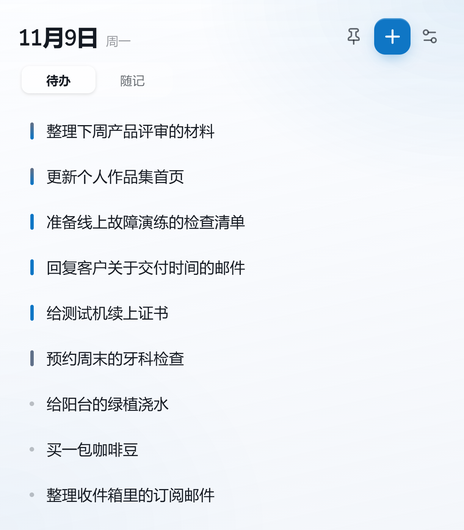

# 浮笺

一个无边框的桌面待办便签，支持 Windows 和 macOS。

[官网](https://fujian.fyi) · [下载](https://github.com/RYMegumi/floating-notes-public/releases/latest) · [隐私说明](https://fujian.fyi/privacy.html)

| 待办 | 随记 |
| --- | --- |
|  |  |

## 功能

- **待办**：只显示标题，点击展开备注；支持重要/紧急排序、归档、恢复和专注模式。
- **随记**：记录临时想法，支持关键词、编辑和归档。
- **AI 关键词**：通过 DeepSeek 提取随记关键词，API Key 使用系统安全存储保存在本机。
- **中文 / English**：界面默认跟随系统语言，也可以在设置中手动切换。
- **登录与同步**：邮箱验证码登录；同一账号可以在不同设备同步任务和随记。

> 登录和同步请使用 **GitHub Releases 中下载的官方安装包**。源码仓库不包含 Supabase 配置；从源码自行构建时，需要按 `.env.example` 配置自己的 `.env.local`。

## 下载

前往 [Releases](https://github.com/RYMegumi/floating-notes-public/releases/latest)：

- **Windows 10 / 11**：便携版 `.exe`，无需安装。
- **macOS**：`.dmg`，当前为 Apple Silicon 版本。

Windows 首次运行可能出现 SmartScreen 提示，这是未签名应用的正常提示。

## 开发

```bash
npm ci
npm run dev
```

环境变量：

```bash
cp .env.example .env.local
```

填入：

```text
SUPABASE_URL=
SUPABASE_PUBLISHABLE_KEY=
```

`.env.local` 不提交到仓库。

常用命令：

```bash
npm run build        # typecheck + 构建
npm run test:ui      # 待办 UI 测试
npm run test:notes   # 随记 UI 测试
npm run test:i18n    # 英文界面测试
npm run build:win    # Windows 便携版
npm run build:mac:dir # macOS .app
```

## 目录

```text
src/main      主进程、窗口、同步、DeepSeek
src/preload   IPC 桥
src/renderer  React 界面
src/shared    共用类型与排序
site          Cloudflare Pages 官网
supabase      数据库迁移与配置说明
docs          平台、安全与预览文档
```

更多文档：

- [跨平台开发](docs/CROSS_PLATFORM.md)
- [macOS](docs/MACOS.md)
- [安全边界](docs/SECURITY.md)

## License

MIT
